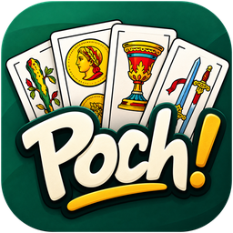
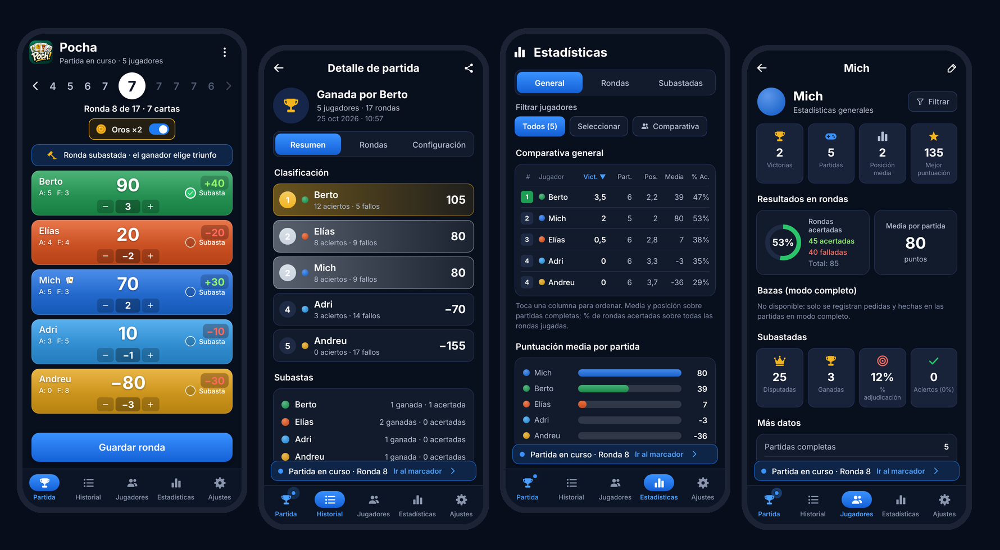

<p align="center">
  
</p>

<h1 align="center">Poch! · Tu marcador de pocha</h1>

<p align="center">
  Marcador, historial y estadísticas para partidas de <b>La Pocha</b> con baraja española.<br>
  Gratis, sin anuncios, sin registro y sin Internet. Y si queréis, en grupo con vuestros amigos.
</p>

<p align="center">
  <a href="https://kolopenco.github.io/Poch-Tu-marcador-de-pocha/"></a>
  &nbsp;
  <a href="https://github.com/kolopenco/Poch-Tu-marcador-de-pocha/releases/latest/download/Poch.apk"></a>
</p>

<p align="center">
  
</p>

---

## Qué hace

- **Marcador en directo.** Una tarjeta por jugador con su total, la variación de la ronda y los aciertos y fallos. Se apunta cada ronda con un par de toques: en modo **sencillo** (cuántas hizo o por cuántas falló) o **completo** (pedidas y hechas).
- **Las reglas de la Pocha, ya hechas.** Rondas que suben, repiten el máximo y bajan; quién reparte en cada ronda; **subastas** con su adjudicatario; **Oros ×2**; y comprobación de que las bazas cuadran antes de guardar.
- **¿Alguien se equivocó?** Cualquier ronda se puede corregir: los totales se recalculan, queda marcada en amarillo y se puede deshacer.
- **Final de partida.** Clasificación con podio. Si hay empate, la app pregunta en ese momento si compartís la victoria o desempatáis a una carta.
- **Historial y estadísticas.** Victorias, posición media, rondas acertadas, subastas ganadas… por jugador o comparando a varios, y también **solo en las partidas que habéis jugado juntos**.
- **Vuestras reglas.** Perfiles con puntuación, multiplicadores por palo, secuencia de rondas y política de empates.
- **Jugar en grupo.** Partidas y estadísticas compartidas entre los móviles de tus amigos (Android y iPhone), con vuestro propio Firebase gratuito y sin cuentas.
- **Copias de seguridad compartibles.** Exporta una copia y pásasela a otro móvil: al importarla elige **sustituir** o **mezclar**, uniendo cada jugador con el tuyo para sumar estadísticas. Android y la versión web usan el mismo formato.

## Cómo instalarla

### iPhone (y cualquier navegador)

1. Abre **[kolopenco.github.io/Poch-Tu-marcador-de-pocha](https://kolopenco.github.io/Poch-Tu-marcador-de-pocha/)** en **Safari**.
2. Pulsa **Compartir** (el cuadrado con la flecha) › **Añadir a pantalla de inicio**.
3. Ya tienes el icono de Poch!: se abre a pantalla completa y funciona sin conexión.

Los datos se guardan en tu propio móvil. Haz una copia de seguridad de vez en cuando (Ajustes › Copias de seguridad).

### Android

1. Descarga **[Poch.apk](https://github.com/kolopenco/Poch-Tu-marcador-de-pocha/releases/latest/download/Poch.apk)** desde la [última versión](https://github.com/kolopenco/Poch-Tu-marcador-de-pocha/releases/latest).
2. Ábrelo y permite instalar desde esta fuente si el móvil lo pide.
3. Las versiones nuevas se instalan encima sin perder las partidas.

También puedes usar la versión web en Android desde Chrome (menú › *Instalar aplicación*).

## Jugar en grupo

Un grupo comparte jugadores, partidas y estadísticas entre vuestros móviles. Cada partida que se cierra se sube, y al abrir la app se bajan las de los demás.

1. **Una persona** crea un proyecto gratuito de Firebase siguiendo la **[guía paso a paso](docs/grupo.md)** (unos 10 minutos) y en Poch! va a **Ajustes › Grupos de juego › Crear un grupo nuevo**.
2. Manda la **invitación** a sus amigos (WhatsApp, correo…).
3. Los demás la abren (iPhone) o la copian y pulsan **Unirse** (Android), dicen **quién son** y unen los jugadores que ya tuvieran.

No hay cuentas ni servidor de Poch!: los datos quedan en el proyecto de Firebase de quien crea el grupo, y solo entra quien tiene la invitación. Un móvil puede estar en varios grupos.

## Pasarse partidas sin grupo

1. Quien tiene las partidas: **Ajustes › Copias de seguridad › Exportar copia** y la envía (WhatsApp, correo, AirDrop…).
2. Quien la recibe: **Importar copia** › **Mezclar**.
3. Para cada jugador de la copia, elige si es uno de los tuyos o uno nuevo. Las partidas se añaden sin duplicarse y las estadísticas se suman.

## Por dentro

| | Android | Web (iPhone) |
|---|---|---|
| Código | Java nativo, interfaz hecha por código, sin librerías | HTML, CSS y JavaScript sin dependencias |
| Datos | En el móvil (SharedPreferences) | En el navegador (localStorage) |
| Grupos | Firebase por REST (`Cloud.java`) | Firebase por REST (`sync.js`) |
| Sin Internet | Sí | Sí (service worker) |
| Lógica y pruebas | `Engine.java` · 21 pruebas | `engine.js` (misma lógica) · 15 pruebas |

```
android/   Código de la app Android (Gradle)
web/       App web publicada en GitHub Pages
tests/     Pruebas de la lógica web y un Firebase simulado (tests/mock-firebase.js)
docs/      Guía de grupos, reglas de Firestore y capturas
```

- La web se publica sola en GitHub Pages con cada cambio en `web/` (workflow **Web**).
- El APK se compila y se sube a **Releases** con el workflow **Android**, que se lanza a mano. La clave de firma está guardada como secreto del repositorio, no en el código.

## Créditos

Idea y diseño: [@kolopenco](https://github.com/kolopenco). Desarrollo con la ayuda de Claude.
Tipografía [Inter](https://github.com/rsms/inter) (SIL Open Font License 1.1, ver `web/fonts/OFL.txt`).
